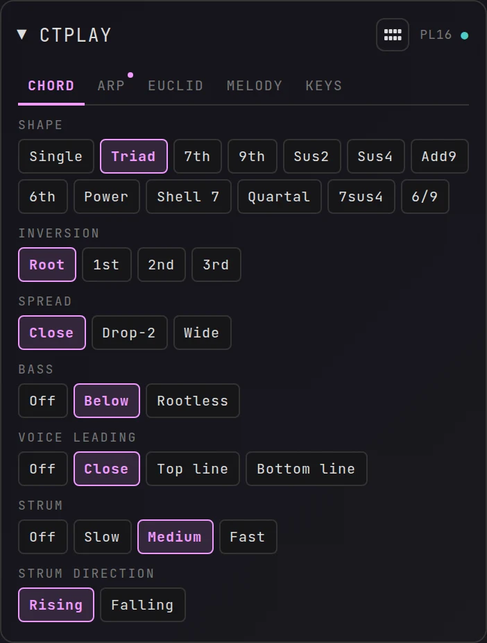
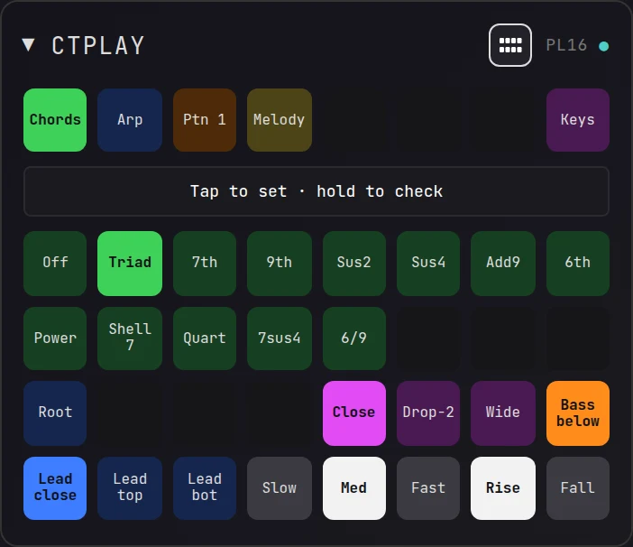
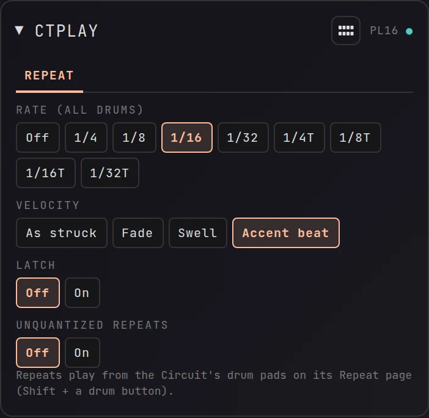
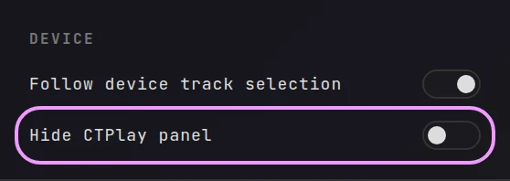

# CTPlay user guide

CTPlay is a modified firmware for the **Novation Circuit Tracks** that adds playing features to the official firmware
1.2.1 (build 4486). Everything else works as on the official firmware, and the changes only take effect when you use
them.

CTPlay is unofficial and not supported by Novation. Use it at your own risk; you can always [go back to the official
firmware](#going-back-to-the-official-firmware).

**Contents:** [Installing](#installing) · [Getting around](#getting-around) · [Recipes](#recipes) · [Chords](#chords) (with
[voice leading](#voice-leading), [strum](#strum), [pattern strum](#pattern-strum), [step entry](#chords-in-step-entry)) · [Arpeggiator](#arpeggiator) · [Mono record](#mono-record) · [Count-in](#count-in) ·
[Euclidean fills](#euclidean-fills) · [Melodic generator](#melodic-generator) · [Drums](#drums) (note repeat, Pattern tools) ·
[Trig conditions](#trig-conditions) ·
[Saved settings](#saved-settings) · [CTCtrl app](#ctctrl-app) ·
[Device limitations](#device-limitations) · [CTPlay's own limitations](#ctplays-own-limitations) ·
[Going back to the official firmware](#going-back-to-the-official-firmware) ·
[Building from source](#building-from-source)

## Installing

The easy way is the **CTPlay uploader**, a web page at
[ctplay.ctctrl.com/uploader/](https://ctplay.ctctrl.com/uploader/). You give it the official Circuit Tracks firmware,
which you download from Novation. The page changes your copy into CTPlay on your computer and sends it to the Circuit
Tracks. Nothing is uploaded, and the page holds no Novation code.

You need:
- a computer with **Chrome or Edge** (the page uses Web MIDI) and a USB cable to the Circuit Tracks;
- the official firmware file for **1.2.1 (build 4486)**, `circuittracks-firmware-4486.syx`. The page links to Novation's
  download. A `.bin` image of the same firmware also works.

**Stay on 1.2.1.** CTPlay is made from the official firmware 1.2.1 (build 4486) and only from it. If Novation
Components offers a newer official firmware and you install it, it replaces CTPlay, and CTPlay can't be made from the
newer file until a CTPlay release supports it. Keep a copy of the 1.2.1 file. (While CTPlay runs, Components shows the
firmware as up to date.)

Before you start:
1. **Back up your projects and the SD card.** Save projects and samples with Novation Components, and copy the SD card
   to your computer. The page asks you to confirm this.
2. Close Novation Components and any DAW or MIDI program: only one program can use the Circuit Tracks' MIDI port.
   That includes browser tabs: close the tab of CTCtrl or another MIDI web page (refreshing it is not enough).
3. Connect the Circuit Tracks directly over USB and power it on normally.

Install:
1. Open the uploader in Chrome or Edge. In step 1, pick the official firmware file. The page checks that it is the
   right one and refuses anything else.
2. In step 2, choose **CTPlay**. The page builds it and checks the result against a published SHA-256.
3. In step 3, press **Allow MIDI**, choose the Circuit Tracks as the output and input, and press **Identify the
   device**. While the Circuit Tracks runs normally, this tells the page which CTPlay build is installed (if any).
4. Switch the Circuit Tracks off. Hold **Scales + Preset + Note** and switch it on: this is the **bootloader**. Press
   **Allow MIDI** again if the page asks, and **Identify the device** again: it must say "bootloader mode".
5. In step 4, tick both boxes: that you backed up, and that you accept the risk of unofficial firmware. Press **Send**
   and confirm.
6. Wait while the bar fills (about 20 seconds). In bootloader mode the Circuit Tracks asks for nothing more. **Do not
   unplug the USB cable or the power while it receives or installs the firmware.**
7. The Circuit Tracks restarts. The page then only says it was received: the Circuit Tracks installs the file only if
   it is a different version from the one installed. When it runs normally, press **Allow MIDI** and **Identify the
   device**. The page says "Installed: CTPlay ..." or that the firmware was not changed.

If you send the build that is already installed, the page warns you before you send: the Circuit Tracks would keep the
old copy. By default the page sends only in bootloader mode. A box in step 3 lets you send to the running firmware.

Your projects, patches and samples stay as they are. CTPlay's own settings (chords, strum, arpeggiator, mono record,
count-in, note repeat, pages) are [saved with the project](#saved-settings); a project that has none starts
with everything off. The count-in's click is stock's metronome: it stays as set when you change project and is off at
power-on, as in stock.

## Getting around

CTPlay's settings sit on **Play pages**, one set for each synth and MIDI track, and pages for the drums. The ones you
change while playing are also on a **Quick view** in the Note view. Stock's own controls keep doing what they do.
CTPlay also uses pads that two of stock's views leave dark: row 4 of the **probability view** and pads 21–24 of the
**drum expanded view**, for [trig conditions](#trig-conditions).

### Play pages

Each of Synth 1, Synth 2, MIDI 1 and MIDI 2 has seven pages: **Chords** (green),
**Arp** (blue), **Pattern tools** and **Pattern tools 2** (orange), **Melody** and **Phrasing** (yellow) and **Keys**
(magenta). The pages you play with most come first; Keys, which you set once, comes last.
Pattern tools and Melody are each one feature on two pages: the second page holds the extra tools.

- **Shift + Synth 1 / 2 or MIDI 1 / 2** opens that track's page from any view: the one you used last, Chords in a new
  project. While Shift is held, those four buttons light up to show they have pages.
- On a page the pads pick settings and play nothing. A bright pad is the current choice, a dim pad another choice, a
  dark pad does nothing.
- **To close it**, press any track button, Note, Mixer, FX or Preset; the button then does what it does in stock.
  Shift + another synth or MIDI track's button goes straight to that track's page.
- **Drum tracks** have their own pages on **Shift + Drum 1–4**, which work the same way: see
  [Drums](#drums).

### Moving between pages

- **▼ / ▲** (the Octave buttons) go to the next / previous page, all seven in order: Chords, Arp, Pattern tools,
  Pattern tools 2, Melody, Phrasing, Keys. Each one lights in the colour of the page it leads to; a dark one has no
  page that way.
- **Hold Shift on a page** for the page list on the bottom row: pad 25 Chords, 26 Arp, 27 Pattern tools, 28 Melody,
  32 Keys, the open one bright. Each page keeps its pad in later releases too: new pages take the dark pads in between.
  Tap one to go there.
- **A feature with two pages has one pad in the list.** Tap it to open the page of that feature you used last. Tap it
  again, while that feature is open, to flip to its other page: pad 27 flips between Pattern tools and Pattern tools 2,
  pad 28 between Melody and Phrasing. Each track remembers which of the two it used last.
- Shortcut: hold Shift, press the track's button, keep Shift held and tap a page in the list.

### Quick view

**Hold Shift in the Note view**: pads 17–32 show the track's Quick view, and pads 1–16 keep their stock Shift
functions. Change a setting there and it changes on the page too.

| Quick view | What it shows | 1-16/17-32 LED (with Shift) |
|---|---|---|
| Chords (the default) | the chord shapes: the Chords page's rows 1–2 | green |
| Arp | the Arp page's rows 1–2: pattern, rate, triplet, dotted, latch | blue |

**Shift + 1-16/17-32** switches between them; the track stays on that one until you switch again. Keys, Pattern
tools (both pages) and Melody (both pages) have no Quick view.

### Page map

Pads as on the device: row 1 at the top, pad 1 top left. Each row starts with its pads and what it sets. *Italic*
rows are the page's Quick view; an empty pad is a free one.

**Chords** (green): the [chord shapes and voicing](#choosing-a-chord), [voice leading](#voice-leading) and [strum](#strum)

<!-- pads: G g g g g g g g / g g g g g · · · / B b b b M m m o / b b b w w w W w -->
| | 1 | 2 | 3 | 4 | 5 | 6 | 7 | 8 |
|---|---|---|---|---|---|---|---|---|
| *1–8* <small>*shape*</small> | *off* <small>*single note*</small> | *triad* | *7th* | *9th* | *sus2* | *sus4* | *add9* | *6th* |
| *9–16* <small>*more shapes*</small> | *power* | *shell 7* | *quartal* | *7sus4* | *6/9* | · | · | · |
| 17–24 <small>inv. · spread · bass</small> | root pos. | 1st inv. | 2nd inv. | 3rd inv. <small>4+ notes</small> | close | drop-2 | wide | [bass](#bass-modes) |
| 25–32 <small>voice leading · strum · direction</small> | close | top line | bottom line | slow | medium | fast | rising | falling |

**Arp** (blue): the [arpeggiator](#arpeggiator)

<!-- pads: G g g g g g g g / B b b b m m · o / M m m m Y · · · / · · · · · · · · -->
| | 1 | 2 | 3 | 4 | 5 | 6 | 7 | 8 |
|---|---|---|---|---|---|---|---|---|
| *1–8* <small>*pattern*</small> | *off* | *up* | *down* | *up-down* | *down-up* | *random* | *as played* | *chord* |
| *9–16* <small>*rate · latch*</small> | *1/4* | *1/8* | *1/16* | *1/32* | *triplet* | *dotted* | · | *latch* |
| 17–24 <small>octaves · gate</small> | 1 | 2 | 3 | 4 | gate | · | · | · |
| 25–32 | · | · | · | · | · | · | · | · |

**Pattern tools** (orange): [Euclidean fills](#euclidean-fills); rows 1–2 preview the rhythm (here 5 hits, after the cycle, the second rhythm and the thinning)

<!-- pads: O o o o O o o O / o o O o o O o o / w w w w Y m M m / c c c c w w B o ; key: Bright: an example, 5 hits, and Undo after a Write. None of the cycle pads (25–28) lit = the whole pattern. Dice notes (30) is dark while the Melody page's order is same and ties are off. -->
| | 1 | 2 | 3 | 4 | 5 | 6 | 7 | 8 |
|---|---|---|---|---|---|---|---|---|
| 1–8 <small>hits</small> | 1 | 2 | 3 | 4 | 5 | 6 | 7 | 8 |
| 9–16 <small>hits</small> | 9 | 10 | 11 | 12 | 13 | 14 | 15 | 16 |
| 17–24 <small>rotate · source · gate · velocity</small> | earlier | later | start | [source](#rhythm-source) | gate | soft | medium | hard |
| 25–32 <small>cycle · dice · Undo · Write</small> | [cycle](#cycle) 3 | 5 | 6 | 7 | [dice rhythm](#dice) | [dice notes](#dice) | Undo | Write |

**Pattern tools 2** (orange): the [second rhythm](#second-rhythm-and-combine) and the [thinning](#thinning); rows 1–2 preview the second rhythm in white (here 5 hits)

<!-- pads: W w w w W w w W / w w W w w W w w / w w w v v v v v / c c c · w w B o ; key: Bright: an example, 5 hits, and Undo after a Write. None lit in combine (20–24) or thinning (25–27) = off. -->
| | 1 | 2 | 3 | 4 | 5 | 6 | 7 | 8 |
|---|---|---|---|---|---|---|---|---|
| 1–8 <small>second rhythm: hits</small> | 1 | 2 | 3 | 4 | 5 | 6 | 7 | 8 |
| 9–16 <small>second rhythm: hits</small> | 9 | 10 | 11 | 12 | 13 | 14 | 15 | 16 |
| 17–24 <small>rotate · combine</small> | earlier | later | start | both | either | one, not both | first without second | accent |
| 25–32 <small>thinning · dice · Undo · Write</small> | [1 in 4](#thinning) | 1 in 3 | 1 in 2 | · | [dice rhythm](#dice) | [dice notes](#dice) | Undo | Write |

**Melody** (yellow): the [melodic generator](#melodic-generator)

<!-- pads: Y y y y y y y y / G g M m m y · · / W b b b b b b b / m m m m w w B o ; key: Bright: the default for a new project, and Undo after a Write. Dice notes (30) is dark while the order is same and ties are off. -->
| | 1 | 2 | 3 | 4 | 5 | 6 | 7 | 8 |
|---|---|---|---|---|---|---|---|---|
| 1–8 <small>order</small> | [same](#order) | up | down | up-down | climb | walk | random | bass |
| 9–16 <small>pool · range · accent</small> | chord | scale | 1 octave | 2 octaves | 3 octaves | [accent](#accents) | · | · |
| 17–24 <small>root</small> | last pad | degree 1 | degree 2 | degree 3 | degree 4 | degree 5 | degree 6 | degree 7 |
| 25–32 <small>octave · dice · Undo · Write</small> | −2 | −1 | 0 | +1 | [dice rhythm](#dice) | [dice notes](#dice) | Undo | Write |

**Phrasing** (yellow): [ties](#ties) and [octave jumps](#octave-jumps) for the melodic generator

<!-- pads: c c c · m m m · / · · · · · · · · / · · · · · · · · / · · · · w w B o ; key: Bright: Undo after a Write. None lit in a row = off. -->
| | 1 | 2 | 3 | 4 | 5 | 6 | 7 | 8 |
|---|---|---|---|---|---|---|---|---|
| 1–8 <small>ties · octave jumps</small> | [ties 1 in 4](#ties) | 1 in 3 | 1 in 2 | · | [jumps 1 in 4](#octave-jumps) | 1 in 3 | 1 in 2 | · |
| 9–16 | · | · | · | · | · | · | · | · |
| 17–24 | · | · | · | · | · | · | · | · |
| 25–32 <small>dice · Undo · Write</small> | · | · | · | · | [dice rhythm](#dice) | [dice notes](#dice) | Undo | Write |

**Keys** (magenta): [mono record](#mono-record) and [chords in step entry](#chords-in-step-entry), one on / off pad each, and [pattern strum](#pattern-strum)

<!-- pads: m g w w · · · · / · · · · · · · · / · · · · · · · · / · · · · · · · · ; key: Bright = on, dim = off. All are off in a new project, as shown. Pattern strum: pad 3 or pad 4 lit, or none (off). -->
| | 1 | 2 | 3 | 4 | 5 | 6 | 7 | 8 |
|---|---|---|---|---|---|---|---|---|
| 1–8 <small>on / off · pattern strum</small> | [mono record](#mono-record) | [chords in step entry](#chords-in-step-entry) | [played](#pattern-strum) | [written](#pattern-strum) | · | · | · | · |
| 9–16 | · | · | · | · | · | · | · | · |
| 17–24 | · | · | · | · | · | · | · | · |
| 25–32 | · | · | · | · | · | · | · | · |

**Repeat** (blue, a drum page: Shift + Drum 1–4): [note repeat](#the-repeat-page), one setting for all four drums

<!-- pads: b b b b m m m m / W w w w · · c o / · · · · · · · · / · · · · O Y V C ; key: Bright: the default for a new project (velocity as struck). Pads 29–32 play the drums, in stock's colours for them. -->
| | 1 | 2 | 3 | 4 | 5 | 6 | 7 | 8 |
|---|---|---|---|---|---|---|---|---|
| 1–8 <small>rate</small> | 1/4 | 1/8 | 1/16 | 1/32 | 1/4T | 1/8T | 1/16T | 1/32T |
| 9–16 <small>velocity · unquantized · latch</small> | as struck | fade | swell | accent the beat | · | · | [unquantized repeats](#recording-repeats) | [latch](#latch) |
| 17–24 | · | · | · | · | · | · | · | · |
| 25–32 <small>drums</small> | · | · | · | · | drum 1 | drum 2 | drum 3 | drum 4 |

**Pattern tools** (orange, a drum page): [drum Pattern tools](#drum-pattern-tools), per drum; rows 1–2 preview the rhythm (here 5 hits)

<!-- pads: O o o o O o o O / o o O o o O o o / w w w w Y m M m / c c c c w · B o ; key: Bright: an example, 5 hits, and Undo after a Write. Pad 21 is the roll, in stock's Gate view colours. Pad 30 is dark: a drum has no notes. -->
| | 1 | 2 | 3 | 4 | 5 | 6 | 7 | 8 |
|---|---|---|---|---|---|---|---|---|
| 1–8 <small>hits</small> | 1 | 2 | 3 | 4 | 5 | 6 | 7 | 8 |
| 9–16 <small>hits</small> | 9 | 10 | 11 | 12 | 13 | 14 | 15 | 16 |
| 17–24 <small>rotate · source · roll · velocity</small> | earlier | later | start | [source](#rhythm-source) | [roll](#drum-pattern-tools) | soft | medium | hard |
| 25–32 <small>cycle · dice · Undo · Write</small> | [cycle](#cycle) 3 | 5 | 6 | 7 | [dice rhythm](#dice) | · | Undo | Write |

**Pattern tools 2** (orange, a drum page): the [second rhythm](#second-rhythm-and-combine), the [thinning](#thinning) and the drum's [accent](#drum-pattern-tools); rows 1–2 preview the second rhythm in white (here 5 hits)

<!-- pads: W w w w W w w W / w w W w w W w w / w w w v v v v v / c c c y w · B o ; key: Bright: an example, 5 hits, and Undo after a Write. None lit in combine (20–24) or thinning (25–27) = off; pad 28 dim = no accent. -->
| | 1 | 2 | 3 | 4 | 5 | 6 | 7 | 8 |
|---|---|---|---|---|---|---|---|---|
| 1–8 <small>second rhythm: hits</small> | 1 | 2 | 3 | 4 | 5 | 6 | 7 | 8 |
| 9–16 <small>second rhythm: hits</small> | 9 | 10 | 11 | 12 | 13 | 14 | 15 | 16 |
| 17–24 <small>rotate · combine</small> | earlier | later | start | both | either | one, not both | first without second | accent |
| 25–32 <small>thinning · accent · dice · Undo · Write</small> | [1 in 4](#thinning) | 1 in 3 | 1 in 2 | [accent](#drum-pattern-tools) | [dice rhythm](#dice) | · | Undo | Write |

### Per track and saved

- Every page setting belongs to its track: Synth 1 can strum 7th chords while Synth 2 plays single notes. The drums'
  Repeat settings are one for all four drums; their Pattern tools settings are each drum's own.
- [Count-in](#count-in) is not on a page: it is Shift + Clear, for the whole project.
- [Trig conditions](#trig-conditions) are not on a page either: each step has its own, set in stock's probability
  view and kept in the pattern, as stock keeps a step's probability.
- Everything is [saved with the project](#saved-settings), including the page each track
  opens on (which page of a two-page feature too) and its Quick view; each drum's page too.

## Recipes

[Recipes](recipes.md) are short step-by-step examples that make something sound good straight away, each from a new
empty project. Each step says what you should hear, so you can check as you go.

## Chords

> **Note:** the Circuit Tracks has limited processing power, and every note a synth plays uses some of it. With
> ordinary patches, chords and strums play in full, even in busy projects. Complex patches (dense oscillators, sync,
> drive, effects turned up) use more power per note, and big chords on them can run out and lose notes, just as the
> official firmware's own pads and steps do. CTPlay keeps chords within what the synth can play where it can, but it
> cannot add power. MIDI 1 and MIDI 2 send every chord note; what sounds is up to the gear they play. See
> [Device limitations](#device-limitations).

In the Note view of **Synth 1, Synth 2, MIDI 1 and MIDI 2**, one pad can play a whole chord. The chord is built from
the project's scale, so it is always in key. With chords off (the default), the pads play single notes as usual.

Pads are numbered 1–32 from the top left. The chord controls are on the **bottom two rows (pads 17–32)**, which are
key pads in both the normal and the expanded Note view.

### Choosing a chord

The shapes are on the track's [Quick view](#quick-view) (hold Shift in the Note view and press a pad) and on rows
1–2 of its [Chords page](#page-map). The voicing is on row 3 of the page. The current choice
in each group is bright, the others dim. A pad acts at once; check it by playing a pad.

**Rows 1–2 (pads 1–13, green): the chord shape.** It is one choice across both rows: pick any pad and it replaces the
shape you had.

<!-- pads: G g g g g g g g -->
| Pad | 1 | 2 | 3 | 4 | 5 | 6 | 7 | 8 |
|---|---|---|---|---|---|---|---|---|
| Shape | off <small>single note</small> | triad | 7th | 9th | sus2 | sus4 | add9 | 6th |
| On C in C major | C | C E G | C E G B | C E G B D | C D G | C F G | C E G D | C E G A |

<!-- pads: g g g g g · · · -->
| Pad | 9 | 10 | 11 | 12 | 13 | 14 | 15 | 16 |
|---|---|---|---|---|---|---|---|---|
| Shape | power | shell 7 | quartal | 7sus4 | 6/9 | · | · | · |
| On C in C major | C G C | C E B | C F B E | C F G B | C E G A D | · | · | · |

The shapes follow the scale: in A minor, the triad on A is A C E (minor), and on B it is B D F.

The five shapes on row 2 in one line each:

- **Power:** the pad's note, its fifth and the octave. Open and strong, with no third, so neither major nor minor.
- **Shell 7:** the root, the third and the seventh, without the fifth. A light, jazzy 7th.
- **Quartal:** notes stacked a fourth apart. An open, modern sound that does not say major or minor.
- **7sus4:** the root, the fourth, the fifth and the seventh. Hanging, waiting to move.
- **6/9:** the root, third, fifth, sixth and ninth. Warm and full, a jazz ending chord.

**Row 3 (pads 17–24): the voicing**

<!-- pads: B b b b M m m o -->
| Pad | 17 | 18 | 19 | 20 | 21 | 22 | 23 | 24 |
|---|---|---|---|---|---|---|---|---|
| Setting | root pos. | 1st inv. | 2nd inv. | 3rd inv. <small>4+ notes</small> | close | drop-2 | wide | [bass](#bass-modes) |
| 7th on C, lowest first | C E G B | E G B C | G B C E | B C E G | C E G B | G C E B | C G E B | [3 modes](#bass-modes) |

- **Inversion** (pads 17–20, blue): the pad's own note stays where it is and the other notes move down an octave, so
  the chord sits around it (in the 1st inversion, E G B sit below the pad's C). A 3-note shape (triad, sus2, sus4) has
  no 3rd inversion: pad 20 plays it in root position. Inversion, spread and bass work on every shape, the row 2 ones
  too.
- **Spread** (pads 21–23, magenta): close as built; drop-2 moves the second-highest note down an octave; wide moves the
  chord's 2nd and 4th notes up an octave.
- **Bass** (pad 24, orange): three [bass modes](#bass-modes).

### Voice leading

With voice leading on, you do not choose the inversion. Each chord you play takes the inversion that sits best
against the chord before it. A progression then moves smoothly, without you touching an inversion pad. The chords stay
within about an octave of the pad you press, so they do not drift away.

The three kinds are on pads 25–27 of the Chords page, blue. One is on at a time. Press the lit one again to turn voice
leading off.

- **Close** (pad 25): the notes move as little as possible from the last chord. This gives the mellow, jazzy sound.
- **Top line** (pad 26): the highest note moves as little as possible. The top of the chords makes a smooth melody.
- **Bottom line** (pad 27): the lowest note moves as little as possible. A smooth left-hand line. With a bass mode on,
  the lowest note is always the bass, so this acts like close.

- While voice leading is on, the inversion pads show the inversion you had set, dim, and the other three are dark.
  Press an inversion pad: voice leading turns off and that inversion is picked. Turning voice leading off brings back
  the inversion you had set.
- The chord before is the last chord you played on that track with a pad. The first chord after you load a project or
  switch on uses the inversion you set.
- A chord keeps its number of notes. Only the choice of inversion changes.
- Pattern tools' Write and the Melody page use the inversion you set, not voice leading, so a write does not depend on
  what you played before it.
- Chords already recorded play back as recorded.
- To check it, use a new empty project (C natural minor), a pad on the same octave for each chord. Pick the triad on the
  Chords page and turn close on. Play the pads C, A♭, F, then C again. You hear, lowest note first:
  C E♭ G, then C E♭ A♭, then C F A♭, then C E♭ G. Each chord keeps at least one note of the one before, and no note
  moves more than 2 semitones. Top line and bottom line give the same four chords here.

Try it: [A chord progression that moves smoothly](recipes.md#a-chord-progression-that-moves-smoothly)

### Bass modes

Pad 24 of the palette cycles three modes per track. Its colour shows the mode:

| Pad 24 | Mode | What a pad plays (9th on C as the example) |
|---|---|---|
| dim orange | **no bass** | the chord as chosen: C E G B D |
| orange | **bass below** | the chord plus its root an octave lower. A 9th leaves out its 5th to stay at 5 notes: C (bass), C E B D |
| white | **rootless over bass** | the pad's note **is** the bass, and the chord sits an octave above it without its root: C (bass), then E G B D an octave up |

- In both bass modes the bass is always the lowest note, whatever the inversion and spread.
- In **rootless over bass**, play an octave lower than without bass to get the chord in the same place. Inversion and
  spread shape the chord above the bass. With the shape off, a pad plays only its own note.
- Why the 9th changes: up to 5 notes play reliably with ordinary patches (see
  [Device limitations](#device-limitations)), so both modes keep every chord at 5 notes or fewer.

### Strum

A chord can be **strummed**: its notes sound one after another instead of all at once, like a strummed guitar.

- Pick the track's strum on pads 28–30 of its [Chords page](#page-map): slow, medium or
  fast. No speed lit means strum is off. Press the lit speed again to turn it off.
- **Direction**, Chords page pads 31–32: **rising** (pad 31, the default) or **falling**
  (pad 32).
  - Rising: the pad's own note sounds when you press it, then the chord's other notes follow, rising. In "bass below"
    the bass comes right after the pad's note; in "rootless over bass" the strum rises from the bass (the pad's note).
  - Falling: every note of the chord from the highest down, the pad's own note in its place, so the bass comes last.
- With an arpeggio pattern on, strum is ignored; the Chords page shows the stored speed and direction
  dim (a stored "off" shows no speed lit).

| Speed | Gap between notes | A 5-note chord takes |
|---|---|---|
| slow | 80 ms | 320 ms |
| medium | 40 ms | 160 ms |
| fast | 20 ms | 80 ms |

- The gap is the same at any tempo, and strum works with the sequencer stopped or playing.
- Strum only affects chords: a pad that plays a single note plays it as before.
- Release the pad mid-strum and the notes that have not sounded yet never sound. Switching to another view stops the
  chord the same way.
- While a chord strums, the pads of its notes light up as each note sounds.
- **Recording a strum:** with stock's record quantise on (the default), each note lands on a whole step, so a recorded
  strum comes back spread over steps, not as a roll. With record quantise off (**Shift + Record**, Record dims) the
  notes keep their timing as microsteps and the strum plays back as a roll. To record plain
  chords, turn strum off. [Pattern strum](#pattern-strum) records a strum as a plain chord (Played) or as an exact roll
  (Written), with record quantise on or off.

### Pattern strum

**Pattern strum** strums the chords of a track's
pattern too, not only the chords you play. Each track has one of three settings, on its [Keys page](#page-map),
pads 3–4 (white):

- **Off** (no pad lit, the default): as stock. The pattern plays its chords as block chords.
- **Played** (pad 3): the pattern keeps plain chords, and CTPlay strums each one as the sequencer plays it.
- **Written** (pad 4): recording and step entry write the strum into the pattern as a **roll**: each note on its own
  microstep, a little after the one before.

How it works:
- Press pad 3 or 4 to pick it. Press the lit pad again for off. The change acts at once.
- Both use the track's strum speed and direction (Chords page, pads 28–32). With the strum off, nothing strums; the
  Keys pads still show the setting.
- Synth 1 / 2 and MIDI 1 / 2. On a MIDI track the notes go out strummed to the external synth.

**Played:**
- On each step where two or more notes start together, the first note (the lowest when rising, the highest when
  falling) plays on the step. The others follow at the strum gap: 80, 40 or 20 ms. Each note keeps its own velocity.
- **The strum releases at once**: each note ends where it would end in the block chord (its
  own length, counted from the step), so a chord whose notes share one gate stops together, as when you let go of a
  strummed chord. A note that starts after that end (a slow strum on a short gate) sounds only briefly.
- The gap is in milliseconds, so the strum sounds the same at any tempo.
- **The track's next notes cut a strum short.** When the track starts a note before the strum has finished, the
  strum's waiting notes do not sound, as when a guitarist changes chord. Empty steps let the strum play out. When
  falling, the bass is the note left out.
- Stop and a mute (in the Mixer) also drop the waiting notes. So does setting pattern strum or the strum speed to off.
  A pattern change does not: the strum plays out.
- **Recording:** a strummed chord you play records as a plain chord: all its notes go on the step (and microstep) of
  its first note. You still hear it strummed while you play, and the pattern strums it.
- Step entry ([chords in step entry](#chords-in-step-entry)) writes the plain chord, and the pattern strums it.

**Written:**
- The gap is counted in the sequencer's ticks (24 a beat): slow 4, medium 2, fast 1. At 120 BPM that is 83, 42 and
  21 ms. A track on Written uses these gaps for its live strum too, so what you hear is what gets written.
- **Recording:** the strum's first note goes where stock puts it (record quantise on or off decides). Each later note
  goes exactly one gap after the one before. This works with record quantise on, so the rest of a project can stay
  quantised.
- **Step entry** (with chords in step entry on): hold a step and press a pad, or the other way round. The roll starts
  at the step's start. The notes that fall in the held step go in at once. The notes that fall in later steps go in
  when you let go of the pad.
- Example, at 1/16 (a step is 6 ticks) and slow, a triad from step 1: C at the start of step 1, E four microsteps later
  in step 1, G in step 2 (its microstep 2).
- A roll longer than a step continues into the next steps. Past the pattern's last step it continues from the
  pattern's first step. From a step outside the pattern's first and last steps, it carries straight on into the
  next steps, and a note past step 32 is left out. A step that already holds 6 notes leaves
  that note of the roll out.
- **The same pad again** (hold the step, press the pad) takes the whole roll out. The notes in later steps go when you
  let go of the pad. A chord that went in as a block chord (while the track was off or on Played), or as a roll at
  another strum speed or direction, goes out whole from the held step.
- The roll is ordinary step notes: it plays the same on the official firmware, and you can edit it note by note.

**Limits** (rare cases):
- Written, at a sync rate slower than 1/16, a microstep is 2 ticks or more. The gaps are rounded to the nearest
  microstep, so a fast strum puts some notes together.
- Written: pad first writes nothing when the strum is falling (as for any chord in step entry). Hold the step first.
- Written, with voice leading on: a roll whose pad note went into a later step is not found by the same pad again,
  so nothing changes. Take its notes out one by one.
- Written: hold one pad and tap several steps, and each step's later notes go in when you let go of the pad. At most
  16 entries wait at a time.
- Written: a roll longer than the pattern leaves out the notes that would wrap round to its start.
- Played: a chord you have just entered in step entry is one step long, as stock's. With a slow strum, its last note
  starts near the end of that step and sounds only very briefly. Make the step longer to hear it.
- A rising strum's tone that a full chord left out (see [Polyphony](#polyphony-how-many-notes-a-synth-holds)) still
  goes into the step when you press the pad first.
- Written: a roll longer than the whole pattern leaves out the notes that would come back onto the held step.
- Written: the same pad again takes out every note of the pad's own pitch in the held step, also one that the
  previous step's roll put there (stock's own rule). The other notes of that roll stay.
- Recording: while Record is on, a rising strum's first note on a Played or Written track sounds up to 1 ms after
  your press (CTPlay sends it). Without Record, it sounds as before.
- Recording: if another chord cuts a strum, if you press the same pad again quickly, or if Record went on during the
  strum, its later notes are recorded where stock puts them. The same for Stop or Record off while you hold a strum,
  and for a note two held chords share.
- Recording, Played: when the first note's step already holds 6 notes, a later note stays where stock puts it.
  Written: it is left out.
- Recording, Written: if you change the strum speed during a strum, each later note uses the speed at its moment.
- Played: a step with MIDI note 0 (below the Circuit's range) plays as a block chord.

Try it: [Off-beat chord stabs](recipes.md#off-beat-chord-stabs)

### Played or Written?

| | Played | Written |
|---|---|---|
| Strums on the official firmware | no (a block chord) | yes |
| Follows tempo changes | yes: the gap stays in milliseconds | no: fixed at the tempo it was written at |
| Change the strum later | yes: speed and direction act at once | no: record or enter it again |
| On the step grid | no | yes, in ticks (exact at 1/16) |
| The step shows | the whole chord | the first notes; the rest in later steps |
| Long strums | cut short when the track's next note starts | continue into later steps, keeping their timing |

- **Played** is for parts that stay on CTPlay and may change tempo: the chord stays one chord in the pattern, easy to
  edit, and you can change the strum at any time.
- **Written** is for patterns that must strum anywhere, also on the official firmware. Its notes sit on the grid as
  ticks, so the roll speeds up and slows down with the tempo: written at 120 BPM, it is twice as slow at 60 BPM.
- At sync rates slower than 1/16, Written rounds the gaps to whole microsteps (see the limits above).
- A Played strum is cut short by the track's next note; a Written roll is not: its notes are in the pattern and play
  as written, over the next chord too.

### Playing

- Press a pad: the chord plays at the pad's velocity (all notes alike). Release it: the whole chord stops.
- While you hold a chord, the pads of its other notes light up in the colour of the pad you pressed.
- **Two chords that share notes:** hold one, add another, then release the second; the notes the first chord still
  holds start again (a new attack) and keep sounding until you release the first.
- On a **MIDI track** the chord's notes go out as MIDI notes, so you can play chords on an external synth.
- **Chromatic scale:** the pads play the chords of the major key of the project's root note (with root C: pad C = C E
  G, pad D = D F A). A pad outside that key keeps its own note and adds the key's next notes above it (triad on C♯:
  C♯ E G).
- **Scales with 5 or 6 notes** (pentatonic, whole tone, …): the chords are built from the scale's own notes, so they
  come out wider and more open.
- **Use a Poly patch** (see [Device limitations](#device-limitations)).

### Recording

With Record on, a played chord is recorded like any notes you play: every note goes into the step (up to 6 per step).
The recorded chords are ordinary notes, so the pattern still plays the same **on the official firmware**. Shared notes
that start again when you release a chord are recorded too, as you heard them.

A note you hold for more than 16 steps is recorded whole, also in a 32-step pattern: it is tied on into the step 16
steps later and ends when you let go. In a pattern of 16
steps or less nothing changes. The note stops early, at the end of its last part, when its next part would land on
the step where it started (in a 32-step pattern: after 32 steps), or on a step that already holds 6 notes.

Entering notes into a held step (hold a step, press key pads) puts only the pad's own note into the step, unless
[chords in step entry](#chords-in-step-entry) is on.

With [pattern strum](#pattern-strum) on Played or Written (and a strum speed set), a strummed chord records as a plain
chord (Played) or as a roll (Written).

### Chords in step entry

**Chords in step entry** makes step entry write the
pad's whole chord into the step: the same notes the pad plays live.

- Turn it on per track on the [Keys page](#page-map): pad 2. Each press switches it on or off at once. Bright green =
  on, dim green = off (stock, the default).
- It works in the Note view with the steps on the top two rows, on Synth 1 / 2 and MIDI 1 / 2, when the pad plays a
  chord (a shape or a bass mode is set). Otherwise step entry works as in stock.
- **Hold a step, then press a pad:** the pad's chord goes into the step, and you hear it while you hold the step.
- **Or hold a pad, then press a step:** the step gets the chord you hear.
- **The same pad again** (hold the step, press the pad) takes the chord out of the step. It takes every note with one
  of the chord's note names (for C E G: every C, E and G in the step), also one you entered by hand.
- Holding a step shows its notes on the key pads, as in stock.
- The notes get the step's longest gate (one step on an empty step) and the velocity of your press (stock's fixed
  velocity, when that is on). A note already in the step is not added again. A step holds 6 notes: the pad's own note
  goes in first, then the chord's other notes from the lowest up, while there is room.
- With [voice leading](#voice-leading) on, each chord leads from the one before, in the order you enter them.
- Not written: the strum (all the notes start together) and the arpeggio (the step gets the chord). With
  [pattern strum](#pattern-strum) on Written, the strum is written as a roll.
- **Pad first writes nothing** when the arpeggiator or a falling strum is on. Hold the step first instead: that
  writes the chord.
- **Pad first also writes nothing** when the pad's own note is already in the step. This includes a note that
  another held pad's chord has just put there: with two pads held, one chord may be left out. Step first does not add
  it either: it takes the chord out, as the same pad again does.
- Pad first, if you let go of the step before the pad: the whole chord sounds until you let go of the pad, as stock
  keeps the pad's own note.
- The written notes are ordinary step notes: they play, edit and save as stock's, also on the official firmware.

Try it: [Off-beat chord stabs](recipes.md#off-beat-chord-stabs)

## Arpeggiator

Held pads can play as an **arpeggio**: their notes one after another, in time with the project. Every held pad's
chord joins in, so one pad plays an arpeggiated chord; with chords off it is a classic arpeggiator.

Its settings are on the track's [Arp page](#page-map): pattern on row 1, rate and latch on
row 2 (both rows also on the [Quick view](#quick-view)), octaves and gate on row 3.

- **Pattern:** "as played" follows the order you pressed the pads; "chord" repeats the held notes at the rate (at most
  the lowest 5).
- **Rate:** triplet and dotted change the rate pad's value (dotted 1/32 does not exist). The arpeggio follows the
  project tempo and swing, playing or stopped, and locks to the sequencer while it plays.
- **Octaves:** the notes repeat one to three octaves higher.
- **Gate:** one pad, like the gate of a step in stock's Gate view: each press makes the notes one sixth of a step
  shorter, from 1/6 back to 6/6 (yellow, legato: the notes join). Default 3/6. While the sequencer plays the gate
  counts its ticks: at 1/32 (3 ticks a note) some gates sound alike.
- **Latch:** let go of the pads and the arpeggio keeps going, also while you play another track; the next press on its
  track replaces the notes; latch off or pattern off stops it.
- **Recording:** arpeggio notes are recorded like played notes, each at its gate's length (at 1/16, k sixths of the
  step; legato the whole step). 1/4, 1/8, 1/16 and dotted 1/8 come back as played; triplets,
  1/32 and dotted 1/16 are performance rates (the recorder puts notes on steps).

Try it: [An arpeggio you can play over](recipes.md#an-arpeggio-you-can-play-over)

## Mono record

For mono patches: on a track set to **mono**, a note you record replaces the notes already on
its step, instead of stacking with them, so a mono synth never jumps between stacked notes. In a loop of two steps or
fewer, the notes still stack.

- Set it on the track's [Keys page](#page-map): pad 1. Each press switches it on or off at
  once. Bright magenta = mono, dim magenta = poly (stock, the default).
- Notes recorded into a step in one pass keep each other: a chord, an arpeggio's chord step, notes you play into the
  same step (with stock's record quantise, Shift + Record, on or off). A note recorded on that step in a later pass
  replaces them.
- Only live recording: entering notes into a held step stacks them as in stock.

## Count-in

**Shift + Clear** steps through four states; Clear's LED shows the state while Shift is
held:

| Clear (with Shift) | red | green | magenta | cyan |
|---|---|---|---|---|
| State | off | metronome | count-in | count-in and metronome |

The metronome is stock's own. With the count-in on, arm **Record** with the transport stopped and press **Play**:
four clicks at the project tempo, Record blinking, then the sequencer starts recording on the next downbeat. Play
during the count cancels it (nothing starts); so does Record, and so does loading a project. The count-in is
[saved with the project](#saved-settings); the metronome stays on across project changes and
is off at power-on, as in stock.

## Euclidean fills

The [Pattern tools page](#page-map) writes **Euclidean
rhythms**: k hits spread as evenly as possible over the steps of the track's current
pattern (3 in 8 is the tresillo, 5 in 16 a clave-like line). What it writes are ordinary steps: they play, edit and
save as stock's, and play the same on the official firmware. The drums have the same pages: see
[Drum Pattern tools](#drum-pattern-tools).

- **Pads 1–16:** pad k = k hits. The pads show the rhythm that Write will write: a hit bright, no hit dim, steps past
  the pattern's length dark. They do not show what is in the pattern now. A pattern longer than 16 steps shows its
  first 16.
- **The pattern's own length** (stock's Pattern Settings: its start and end step) decides how many steps the hits
  spread over: a 12-step pattern gets k hits in 12 steps, from its start step.
- **Rotate:** pad 17 moves the hits one step earlier, pad 18 one step later, pad 19 back to the start (the first step
  is a hit).
- **Rhythm source** (pad 20): dim white = Euclid (the default),
  bright white = **groove**. Groove also writes k hits, but it picks the steps by their place in the bar: the first
  beat first, then the other beats, then the steps just before a beat, and so on. A low k gives the strong beats; a
  higher k adds the weaker steps. The rest is a little random, so each dice press (below) gives another groove. The
  hit pads, rotation and the preview work the same for both.
- **Gate** (pad 21) as on the Arp page, default 3/6. Each press makes the note shorter: 3/6, 2/6, 1/6, then **to the
  next hit** (white), then 6/6, 5/6, 4/6 and 3/6 again. With "to the next hit" every note
  lasts until the next hit, and the last one until the first hit of the next loop: a legato line.
  **Velocity** (pads 22–24): soft, medium (the default), hard.
- **Dice** (pads 29 and 30): see [Melodic generator](#dice). On this page they change the rhythm or the notes, and
  the preview shows a new rhythm at once.
- **Write** (pad 32): press once and it blinks, press again to write; any other press cancels. The pattern changes
  when you **lift your finger** from the second press, not when you press. The rhythm **replaces
  the steps of the pattern the track is on**: every hit gets the **last pad you played** on that track, with its chord
  when the track's chord is on (before any pad: the root note), and every other step is emptied. The pattern's length,
  sync rate and automation stay. Writing while the pattern plays changes it at once. If you use the new settings (the
  groove, "to the next hit", the cycle, a combine, thinning, or anything on the [Melody page](#melodic-generator) or Phrasing), Write works as a
  [draft](#the-draft) after its first two presses.
- **Undo** (pad 31, blue) puts the pattern back as it was before the last Write. It works when you lift your finger
  from the pad: you do not press Write after it. To check it, play the pattern or look at the Note view's step pads; the Pattern tools pads stay the
  same, because they show the rhythm, not the pattern.
  - Press Undo again to bring the Write back. Each press swaps between the two.
  - Write after an Undo writes the rhythm on the pads again, over the pattern Undo brought back.
  - There is one Undo: the last Write only, on the track that made it. Loading a project removes it.
- Hits, rotation, rhythm source, gate, velocity and the tools below are per track and [saved with the
  project](#saved-settings), and so is the last played pad; Undo is not.

### Cycle

- **Cycle** (pads 25–28, cyan): 3, 5, 6 or 7 steps. The rhythm is worked out
  over that many steps and then repeated along the pattern, so it drifts against the bar: 3 hits in a 5-step cycle is a
  riff that comes round every 5 steps. Rotate turns it inside the cycle.
- None lit (the default) = the whole pattern. Press the lit pad again to turn the cycle off. A cycle as long as the
  pattern or longer changes nothing.
- It acts on the first rhythm only, and the preview shows it at once. The pattern changes when you Write (or in a
  [draft](#the-draft)). To check: pick 3 hits and cycle 5, and the preview shows the same group repeating.

### Second rhythm and combine

The second rhythm is on **Pattern tools 2** (pad 27 again, or ▼ from Pattern tools). It is a
second Euclidean rhythm over the whole pattern, with its own hits (pads 1–16) and rotation (pads 17–19). Its own
preview, in white, shows it. With combine off it does nothing.

- **Combine** (pads 20–24, violet; none lit = off, press the lit pad to turn it off) says what the two rhythms make
  together:

| Combine | The hits that Write uses |
|---|---|
| both | steps where both rhythms hit |
| either | steps where either hits |
| one, not both | steps where only one of them hits |
| first without second | the first rhythm, minus the steps where the second hits |
| accent | the first rhythm unchanged; its hits on the second's steps play hard |

- The Pattern tools page's preview shows the result, the rhythm Write will write. If nothing is left (for example
  "both" with nothing in common), the Write pad is dark and Write writes nothing.
- The accent sets the hit to full velocity, as the Melody page's accent does; if either asks for an accent, the hit plays hard.

### Thinning

- **Thinning** (Pattern tools 2, pads 25–27, cyan; none lit = off): drops about 1 in 4, 1 in 3 or 1
  in 2 hits at random, after the cycle and the combine. The first hit is never dropped, so some always stay.
- The dice rhythm (pad 29) picks which hits go. The preview shows what is left. The same settings and dice always give
  the same result.

Try it: [A riff that drifts against the beat](recipes.md#a-riff-that-drifts-against-the-beat)

## Melodic generator

Euclidean fills decide **when** notes play. The **Melody page** (yellow, pad 28 in the page list) decides **which
notes** they play. Together, Write turns the two into a bass line or a melody in the track's current pattern in a few
presses. What it writes are ordinary steps, as Euclidean fills write.

There are two layers:

- **Rhythm** (Pattern tools page): the number of hits, rotation, groove or Euclid, gate and velocity.
- **Notes** (Melody page): the root, the pool of notes, the range, the order and the accents.

The default order is **same**: every hit plays the last pad and its chord, exactly as Euclidean fills did before. If
you never open the Melody page, nothing is different. **Write** and **Undo** are on pads 31 and 32 of every page of Pattern tools and
Melody and are the same two pads: one Undo for both.

The pads show settings. They do not show the notes: you hear them. A bright pad is the current choice, as everywhere.

### The notes

- **Root** (row 3). Pad 17, **last pad** (the default): the notes start from the last pad you played on the track, as
  Euclidean fills do. Pads 18–24, **degree 1–7**: the notes start from that degree of the project's scale, so you do
  not need to play a pad first. Chromatic uses the major scale. A scale with fewer than 7 notes goes on into the next
  octave: in a 5-note scale, degree 6 is the root one octave up. A degree root comes back exactly after a project load,
  and so does "last pad": the last pad you played is saved with the project.
- **Octave** (pads 25–28, a degree root only): −2, −1, 0, +1. The default 0 puts the root in the middle-C octave
  (with the project root C, the note C4); −1 and −2 are one and two octaves lower, +1 one higher. Use −2 for a bass. The pads are dim and do nothing while the root is "last pad", because the
  pad you played already has its octave.
- **Pool** (pads 9–10): the notes the order picks from. **Chord** = the root's chord, built with the track's [chord
  settings](#choosing-a-chord) (with the shape off, a triad). **Scale** = the root and every note of the scale above
  it. If you played a note outside the scale, that note is still the root.
- **Range** (pads 11–13): 1, 2 or 3 octaves. The pool goes that far up. Notes outside the Circuit's range are left
  out.
- **Order** (pads 1–8): how the hits walk through the pool. Every order except same plays **one note
  per hit**, not chords.

| Order | What the hits play |
|---|---|
| same | the last pad's chord on every hit (the default) |
| up | the pool upwards, again from the bottom |
| down | the pool downwards |
| up-down | up, then down; the end notes are not played twice |
| climb | two steps up, one back |
| walk | a random walk: each hit moves up to two places, most often one, and sometimes repeats; it turns round at the ends |
| random | a random pool note, never the same one twice in a row |
| bass | the root on the first hit and on most hits on the beat; the other hits mostly the root or its fifth |

The same settings and the same dice always write the same notes.

- **Accent** (pad 14, a cycle): each press steps on. Off · **first hit** · **on the beat** (hits on
  steps 1, 5, 9 and 13) · **every 3rd hit**. An accented note plays at full velocity (127). The other notes play at
  the velocity you chose on Pattern tools, so choose soft or medium to hear the accent. With hard, an accent changes
  nothing.

### Ties and octave jumps

These two are on the **Phrasing** page (pad 28 again, or ▼ from Melody). Both have the same
three amounts: about 1 in 4, 1 in 3 or 1 in 2. None lit = off; press the lit pad again to turn it off. Nothing sounds
until you Write (or in a [draft](#the-draft), where a pick re-writes the pattern when you lift your finger).

- **Ties** (pads 1–3, cyan): some hits (never the first) **hold the note before** instead of
  striking a new one, so a note lasts two or more hits. The line does not skip ahead on a tied hit: the next struck
  hit plays the note the order would have played next. So ties change the rhythm you hear, not the tune. They work in
  every order, same included. A tied hit is never accented, and the accent counts struck notes only.
  - Ties are stock's own: the Micro Step view shows them as ties, and you can edit them there.
  - On a pattern longer than 16 steps, a hit tied to one more than 16 steps away is struck again (stock's longest note
    is 16 steps).
  - To check: Write, then listen: some notes are longer. Or open the Micro Step view on a tied step.
- **Octave jumps** (pads 5–7, magenta): some notes jump an octave up (an octave down when up is
  beyond the Circuit's range). It acts on notes of a line order only: not on order same, not on the first hit, not on
  a tied hit.
- The dice notes (pad 30) draw both again. Ties, jumps and the thinning do not move each other: changing one amount
  keeps the other draws.

### Dice

- **Dice rhythm** (pad 29 on every page of Pattern tools and Melody): picks a new rhythm and keeps the notes. In Euclid it turns
  the hits to a new rotation; in groove it picks a new groove. Every press gives a rhythm different from the one
  before. Only when no other rhythm exists (no hits, or a hit on every step) does nothing change.
- **Dice notes** (pad 30): picks new notes and keeps the rhythm. Every press gives notes different from the ones
  before, unless the pool has only one note. It is dark and does nothing while the order is same, unless
  [ties](#ties) are on: then it draws the ties again.
- A dice press changes **only the settings**. The Pattern tools preview shows a new rhythm at once, but the pattern is
  written only by Write, unless you are in a [draft](#the-draft).

### Writing and Undo

- **Write** (pad 32) needs two presses the first time: the first makes the pad blink, the second writes. The new
  steps replace the pattern the track is on, and the old ones are kept for Undo. The pattern changes when you lift
  your finger from the pad.
- **Undo** (pad 31, blue) goes back to the pattern from before your first Write. It acts when you lift your finger.
  You do not press Write after it. Press Undo again to bring the last Write back.

### The draft

Hearing a melody takes many tries, so after the first Write the pattern is a **draft**, if you use a new setting. A
new setting is: an order other than same, the groove, a degree root, an accent, the gate "to the next hit", a
cycle, a second rhythm's combine, thinning, ties or octave jumps. With
only the old settings (plain Euclid), every Write takes two presses, as before.

In a draft:

- **Every press on Pattern tools, Melody or their second pages writes**: a dice pad, a hit pad, the order, the root, any setting.
  You do not press Write again. The pad lights at once, and the pattern changes when you lift your finger. It
  changes while it plays. If two pads are down, it writes once, when you lift the last one pressed.
- **The Write pad is bright orange and steady.** That is how you see that a press now writes. Outside a draft it is
  dim orange, and it blinks when armed.
- Pressing Write itself also writes again (one press, on the lift).
- **Undo** puts back the pattern from before the first Write and ends the draft. You can press Undo again to get the
  last draft back.
- ▲ and ▼ between the track's pages keep the draft. A press on the Chords page, or on the Arp page, does not write.
  If you change the chord there, the next press on one of the four writing pages writes with it.
  A press that changes nothing (a dark pad, ▲ ▼, or a dice press that cannot change anything) leaves a pending
  re-write alone.
- **The draft ends** when you close the pages (press a track button, Note, Mixer, FX or Preset), when you press Undo,
  when you load a project and when CTCtrl changes these settings. The next Write takes two presses again.
- On a chained track the pattern that plays changes every bar. The draft keeps writing to **the pattern of its first
  Write**.

To check: after the first Write the Write pad turns bright orange. Press a dice pad, and listen: the pattern has
changed. Press Undo: the pad turns dim orange again and your old pattern is back.

### Saved

The Melody and Phrasing settings and the dice seeds are [saved with the project](#saved-settings), per track, with
the last played pad. A draft and Undo are not. In the [CTCtrl app](#ctctrl-app) they are on the Melody tab
(Phrasing too).

Try it: [A melody from a 9th chord](recipes.md#a-melody-from-a-9th-chord) · [A bass line](recipes.md#a-bass-line)

## Drums

Two things for the drum tracks:
- **Note repeat**: hold a drum pad and it repeats in time, at a rate you pick. Stock records
  the repeats as if you had played them.
- **Pattern tools**: write Euclidean rhythms into a drum's pattern, as on the synth tracks
  ([below](#drum-pattern-tools)).

### Drum pages

- **Shift + Drum 1, 2, 3 or 4** opens that drum's page from any view. If that drum is not on screen, the Circuit
  switches to it first, as the Drum button does in stock.
- While Shift is held, the Drum 1–4 buttons light up too, like Synth 1 / 2 and MIDI 1 / 2.
- A drum has three pages: **Repeat** (blue), **Pattern tools** and **Pattern tools 2**
  (orange). ▲ ▼ go through them in that order, as on the synth tracks.
- **Hold Shift on the page** for the drum page list on the bottom row: pad 26 Repeat, pad 27 Pattern tools, the open
  one bright. The other pads are dark. Tap pad 27 again while Pattern tools is open to flip to Pattern tools 2. Repeat
  sits on the synth tracks' Arp pad: both repeat what you hold, in time.
- Each drum opens on the page it used last: Repeat in a new project.
- **To close it**, press any track button, Note, Mixer, FX or Preset, as on the other Play pages. Shift + another
  drum's button goes straight to that drum's page.

### The Repeat page

The pads are in the [page map](#page-map). **One setting for the kit:** the page shows the same settings whichever
drum opened it, and they apply to all four drums.

- **Pads 29–32 play drums 1–4**, as in stock's expanded drum view (the Note button on a drum), in the same colours. A
  pad is white while its drum's hit sounds. They are velocity-sensitive.
- **No rate lit** (the default): each press plays the drum once.
- **A rate lit** (pads 1–8: 1/4, 1/8, 1/16, 1/32 and their triplets): hold a drum pad and it repeats.
  - The first hit sounds at once.
  - While the sequencer plays, the repeats follow its grid, in time with the steps and the swing. Stopped, they run
    at the project's tempo and swing, timed from your press.
  - A grid point less than half a repeat after your press is skipped, so a press never sounds twice.
  - Let go and the repeats stop. Hold several drum pads and each one repeats.
- **The lit rate pad again** turns the rate off (none lit).
- **Change the rate while you hold a pad:** the repeats change at the next grid point. Nothing restarts.
- **Press Play or Stop while you hold a pad:** at Play the repeats move onto the sequencer's grid, with no two hits
  close together. At Stop they go on, at the same tempo, on the same grid. Fade and swell (below) may jump to their
  end value at Play or Stop, or start again at Play.
- **Leave the page while you hold a pad** (the Note button, another track): that drum stops at once.

Try it: [Hi-hats played live](recipes.md#hi-hats-played-live)

### Latch

**Pad 16** (orange) turns latch on and off.
- With latch on, tap a drum pad: its repeat starts and goes on after you let go. Tap it again to stop it.
- A latched drum's pad pulses white. Latched drums keep going after the page closes.
- Turning latch off stops them all. So does turning the rate off (no rate lit), and so does loading a project.
- With no rate lit, latch does nothing: a drum pad plays the drum once per press, as with latch off.

### Velocity

Pads 9–12 shape the repeats' velocity, from how hard you pressed the pad:
- **As struck** (the default): every hit as hard as your press.
- **Fade:** from your press's velocity down to a quarter of it over one beat, then it stays there.
- **Swell:** from a quarter up to your press's velocity over one beat, then it stays there.
- **Accent the beat:** hits on the sequencer's quarter notes as hard as your press, the others at two thirds. Stopped,
  the quarter notes count from your press. A press off the beat sounds at two thirds.

Two limits come from the Circuit, not from CTPlay:
- **Stock's fixed velocity** setting makes every live drum hit 96, the repeats too. With it on, the four shapes sound
  the same.
- **A softer hit does not restart a drum** that is still sounding: each drum is one voice. So a fade at a fast rate on
  a long sample may thin out. A swell always restarts the drum (each hit is louder).

### Recording repeats

With Record on and the sequencer playing, every repeat is recorded like a finger hit: stock's recorder records it.
CTPlay records nothing itself. Stopped, or during a count-in, nothing is recorded.

- **Rec Quantise** (stock's Shift + Record) decides the timing. On, each hit goes on a whole step, one per step, so
  1/32 and the triplet rates do not come back as you heard them. Off, each hit keeps its exact timing.
- **Unquantized repeats** (pad 15, cyan): on, the repeats record at their exact timing even with Rec Quantise on.
  CTPlay does not change stock's setting: Shift + Record shows it as you set it.
  - While any drum repeats (or a latched drum plays), **every drum** records unquantized, finger hits included (on
    this page or in stock's drum views).
  - Once no drum repeats, recording follows Rec Quantise again.
- **One velocity per step:** stock keeps one velocity for each step's hits. Fade and swell come back as a staircase,
  and the hits that share a step (at 1/32 and the faster triplets) share its velocity.
- **A muted drum** (Mixer) still sounds and records from the pads, as finger hits do in stock.

The Repeat settings (rate, velocity, unquantized repeats, latch) are [saved with the project](#saved-settings), one set
for the kit, and so is each drum's page. In the [CTCtrl app](#ctctrl-app) they are on a drum track's Repeat tab.

### Drum Pattern tools

**Pattern tools** and **Pattern tools 2** (orange, pad 27 of the drum page list) write a rhythm into a drum's pattern, as [Euclidean fills](#euclidean-fills) do on a
synth track. They have the same pads for the same things and work the same way: the hit pads and their preview, rotate,
the [rhythm source](#rhythm-source) (groove), velocity, the [cycle](#cycle), the [second rhythm and
combine](#second-rhythm-and-combine), [thinning](#thinning), [dice rhythm](#dice), Write, Undo and the
[draft](#the-draft). The pads are in the [page map](#page-map). Each drum has its own settings.

What is different on a drum:
- **Roll** (pad 21, where a synth track has the gate): 1, 2 or 3 hits in each step of the rhythm. Each press steps on:
  1 → 2 → 3 → 1. The pad shows it in stock's Gate view colours: 1/6 for one hit, 3/6 for two, 6/6 for three. The
  hits are stock's micro steps: two hits = the 1st and 4th of the step's six, three hits = the 1st, 3rd and 5th.
- **Accent** (Pattern tools 2, pad 28): off · first hit · on the beat (steps 1, 5, 9 and 13) · every 3rd hit, as the
  Melody page's [accent](#accents) and in its colours. An accented hit is written at full velocity (127): choose soft or
  medium to hear it.
- **No notes:** dice notes (pad 30) is dark and does nothing, and a drum has no Melody page.
- **Velocity:** soft 48, medium 96, hard 127.

**What Write writes.** As on a synth, the pattern changes when you lift your finger from Write's second press:
- Each hit: its velocity, probability "always", the drum's own sample (no sample flip) and the roll's micro steps.
- Every other step is emptied, inside and outside the pattern's start and end step. The pattern's length, sync rate
  and automation stay.
- They are ordinary stock steps: the step pads and stock's Velocity, micro step and Probability views show them, and
  you can edit them there. To check a Write: press the drum's button (the page closes) and look at the step pads, or
  play.
- **Which pattern:** the one the drum's step pads show. That is the pattern that plays, except after **Shift +
  Patterns** (stock's pattern follow off): then a chain moves on while the step pads stay on one pattern, and Write
  writes that one. On a synth track Write writes the pattern that plays.
- **While recording:** Write works. Hits stock records into that pattern after the Write (your pads, or note repeat)
  are added to it.

**Undo** (pad 31): each drum has its own, apart from the synth and MIDI tracks' one Undo. It puts back the whole
pattern from before the Write. So if you edited the written pattern in stock's views, Undo takes those edits away too,
and Undo again brings back the Write with your edits. The same happens on a synth track.

**The draft:** a Write starts a [draft](#the-draft) when the groove, a cycle, a combine, the thinning or an accent is
on. The roll alone does not: with only hits, rotation, velocity and the roll, every Write takes two presses.

**Note repeat on these pages:** a latched drum keeps repeating while any drum page is open. Pads 29–32 here are dice,
Undo and Write: they do not play the drums.

The settings of both pages are [saved with the project](#saved-settings) for each drum, with the dice seed, and so is
the page the drum was on. Undo and a draft are not. The CTCtrl link carries them (not the dice seed), but CTCtrl 1.2.4
has no tab for them yet.

Try it: [A beat from four drums](recipes.md#a-beat-from-four-drums)

## Trig conditions

**Trig conditions** let a step play only on some
passes of its pattern: the 2nd of every 2, passes 1 and 3 of 4, only the first time, only during a fill. A one-bar
pattern can then sound like eight bars. They work on every track: drums, synths and MIDI.

You set them per step in stock's **probability view** (Shift + Pattern Settings), on **row 4**, which the official
firmware leaves dark. Rows 1–3 stay as in stock: the steps, and on row 3 the selected step's probability. Row 4 shows
the condition of the step row 3 shows.

### Passes

<!-- pads: C c c c C c c c ; key: Bright: an example, a cycle of 8 passes playing on passes 1 and 5. A shorter cycle leaves the pads past it dark. -->
| | 1 | 2 | 3 | 4 | 5 | 6 | 7 | 8 |
|---|---|---|---|---|---|---|---|---|
| 25–32 <small>passes</small> | pass 1 | pass 2 | pass 3 | pass 4 | pass 5 | pass 6 | pass 7 | pass 8 |

- **Hold a pad half a second or more:** the step plays on a cycle of that many passes, on its pass 1 (pad 28 = a
  cycle of 4). The pads up to the cycle's length light dim cyan, the passes it plays on bright cyan, the pads past it stay
  dark. After half a second, while you still hold the pad, row 4 already shows the result; it is written when you let
  go.
- **Tap a pad** inside the cycle: the step plays on that pass too (bright), or no longer (dim). Any mix works: passes
  1 and 3 of 4, only pass 5 of 7. Every pass ticked plays every pass.
- **Hold another pad** to change the length: the ticked passes that still fit are kept (if none fit, pass 1).
- **To clear the condition:** hold the cycle's length pad again, hold pad 25 (pass 1), or untick the last ticked pass.
- A tap past the cycle, or on a step with no condition, does nothing.

How the passes count:
- Each pattern of each track counts its own passes. Pass 1 is the first time through after the count starts over.
  A cycle of 4 with pass 2 ticked (Elektron's "2:4") plays on passes 2, 6, 10 and so on.
- **The count starts over** when you choose: Play from stop, a pattern or chain picked by hand (when it takes over;
  with Shift + its pad at once), a scene recalled (every track, when it takes over), a project loaded.
- **It goes on** while a pattern loops, while a chain or a scene chain advances by itself, and after Shift + Play
  (continue). A pick still waiting at Stop starts its track over when it takes over, after Shift + Play too.
- A pass that a scene chain cuts short as it advances by itself still counts as a pass. A scene you recall by hand
  starts every track over instead.
- The counts are not saved.

### Special conditions

<!-- pads: g g o o v v y y ; key: With Shift held. Bright = the step's special (none here). On a synth or MIDI track pads 27–28 are dark. -->
| | 1 | 2 | 3 | 4 | 5 | 6 | 7 | 8 |
|---|---|---|---|---|---|---|---|---|
| 25–32 <small>with Shift</small> | FIRST | NOT FIRST | [FILL](#fill) | NOT FILL | PRE | NOT PRE | LAST | NOT LAST |

**Hold Shift:** row 4 shows the special conditions, one pad each. Tap one to set it; the lit one again clears it. A
step has a special or a cycle, never both: setting one replaces the other. Without Shift, a step with a special shows
all 8 pads dim in its colour; a tap there does nothing, and holding a pass pad replaces the special with a cycle.
Shift counts when you press the pad.

| Special | The step plays when |
|---|---|
| FIRST | it is the pattern's first pass since its count started over |
| NOT FIRST | it is any later pass |
| FILL | the drum's [FILL](#fill) is on |
| NOT FILL | the drum's FILL is off: the step drops out during fills |
| PRE | the track's last conditional step played |
| NOT PRE | the track's last conditional step did not play |
| LAST | a pattern or scene you picked waits to take over |
| NOT LAST | no pick waits |

- **FILL and NOT FILL are for drums only:** on a synth or MIDI track their pads stay dark and do nothing.
- **PRE links two steps' chance.** The track's last conditional step is its last step with a condition (not PRE or
  NOT PRE) or a probability below always. PRE plays when that step really sounded (its condition and its probability
  roll), NOT PRE when it did not. PRE steps themselves do not change it, and it looks back across the pass's end.
  Until the track's first conditional step after the count starts over, PRE is silent and NOT PRE plays.
- **LAST** is true from your pick until the takeover: for a pattern picked in the Patterns view, the rest of the
  current pass; for a scene, every track until Drum 1's pattern ends (a short pattern may loop through it more than
  once). It is never true while a chain advances by itself. Use it for a turnaround that plays only as you change
  part.

### FILL

<!-- pads: · · · · o o o o / · · · · o y v c ; key: Dim orange = FILL off; bright orange while on, yellow while armed. Rows 1–2 stay dark. Pads 29–32 play the drums, as in stock. -->
| | 1 | 2 | 3 | 4 | 5 | 6 | 7 | 8 |
|---|---|---|---|---|---|---|---|---|
| 17–24 <small>FILL</small> | · | · | · | · | drum 1 | drum 2 | drum 3 | drum 4 |
| 25–32 <small>drums</small> | · | · | · | · | drum 1 | drum 2 | drum 3 | drum 4 |

Each drum has its own FILL, on stock's **drum expanded view** (press a drum's button, then Note): **pads 21–24 are
FILL for drums 1–4**, each right above its drum pad.
- **Hold** the pad: that drum's FILL is on while you hold it (bright orange).
- **Tap** it while playing: FILL is armed (yellow), then on for the drum's whole next pass, from its start to its end
  (bright orange), then off by itself. Tap again while it is armed or filling to cancel it at once. After a fill, one
  tap arms it again.
- A tap is a short hold too: a FILL step that starts during the tap fills.
- Stopped, a tap does nothing. **Stop** cancels an armed or running fill.
- A drum page (Shift + Drum N) covers these pads while it is open, as it covers the whole view. Stop still cancels a
  fill then.
- The synth and MIDI tracks have no FILL yet (their FILL and NOT FILL pads stay dark).

### Conditions and probability

- A step plays only when its condition lets it **and** its probability roll (row 3) passes: pass 1 of 2 at 50 % plays
  on about half of the odd passes.
- A step a condition silences behaves exactly as a failed probability roll: no note, no hit, no flip sample. On a
  [Played](#pattern-strum) track it is not strummed, and it does not cut the previous step's strum.

### Editing a step

- Row 4 edits the step stock's row 3 edits: **stopped**, the step you tapped last; with a **step pad held**, that step.
  While playing, the selection follows the playing step (row 4 then shows each step's condition as it plays) and a
  press does nothing, unless you hold a step pad or turn that off with Shift + Patterns (stock's toggle).
- A condition needs a hit (drums) or a note (synths, MIDI): on an empty step row 4 does nothing, and adds no hit as
  row 3 would.
- Every change is written when you let go of the pad.

### Stock's edits

The conditions stay with their steps through stock's own editing:
- **Duplicate** (a pattern), **copy 1-16 → 17-32**, **paste** a step and **Mutate** carry each step's condition with
  it.
- **Clear** (a step or a pattern) clears it, and so does taking out a step's last hit or note: a drum step pad tapped
  off, a step held with the lower pad of its flip sample, the last microstep off in a drum's microstep view, the key of
  a step's last note. A hit or note added later starts with no condition.
- CTPlay's own Write ([Pattern tools](#euclidean-fills), [Melody](#melodic-generator), the drums'
  [Pattern tools](#drum-pattern-tools)) clears the conditions of the steps it writes; its Undo brings them back.

### In the project

- The conditions are part of the pattern and are saved with it. On the official firmware a project with conditions
  plays every step on every pass.
- **A project from elsewhere** (made on the official firmware, or a pack from elsewhere) plays exactly as
  before: CTPlay reads no condition in it until you write the first one. That first one clears every condition of the
  project (other firmwares may have left bytes there) and marks it as CTPlay's; save the project to keep them.
- The pass counts start over at every load. Neither they nor FILL are saved.

Try it: [A snare roll every 4th bar, and a fill when you want it](recipes.md#a-snare-roll-every-4th-bar-and-a-fill-when-you-want-it)

## Saved settings

CTPlay's settings travel with the project: **save the
project** (Save, Save, as in stock) and loading it again, later or after a power cycle, brings them back on every
track: the chord, bass mode and strum settings, the arpeggiator (Latch too), mono record, chords in step entry, pattern strum, the page Shift + the track's
button opens, the Quick view, the count-in, the Pattern tools settings (both pages), the Melody and Phrasing settings (with the dice seeds), the last played pad,
for a feature with two pages the page each track was on, and the drums' Repeat settings, Pattern tools settings
(both pages, per drum) and pages.

- A setting is kept only when you save the project, like stock's own edits. Changing a CTPlay setting does not mark
  the project as changed.
- A project that has no CTPlay settings (made on the official firmware, by an older CTPlay or by another modified
  firmware, or a new project) loads with everything off.
- Notes you hold while a project loads end normally when you let go, and a count-in is cancelled. A latched arpeggio
  stops, unless you are holding a pad of its track and the loaded project has the arpeggiator on for that track: then
  it ends when you let go of the pad (Latch off in the loaded project) or at your next press there (Latch on).
- The settings sit in a part of the project file the official firmware keeps but never reads: a CTPlay project plays
  the same on the official firmware, and saving it there keeps the settings for when you are back on CTPlay.
- **Projects from another CTPlay release.** A release that is older or newer than the one that saved the project
  loads the settings it knows and gives the rest their defaults. When you save, it keeps the bytes it does not know,
  so a newer release's settings come back when you return to it.
- What is not saved: the notes you are holding or latching (latched drums too), the open page, a count-in in progress, Pattern tools'
  Undo, a draft, the trig conditions' pass counts and FILL. The trig conditions themselves are in the patterns.

## CTCtrl app

[CTCtrl](https://ctctrl.com/) is a web app for a phone, tablet or computer that works with the Circuit Tracks
over USB, in a browser with Web MIDI: Chrome, Edge or Firefox on a computer, Chrome on Android. iPhone and iPad browsers
do not have Web MIDI. On CTPlay it shows a **CTPlay panel** with the Play settings of the
selected track:

- **A synth or MIDI track:** five tabs. **Chord** (shape, inversion, spread, bass, voice leading, strum), **Arp**,
  **Euclid** (the Pattern tools settings), **Melody** (the Melody and Phrasing pages) and **Keys** (mono record and the
  count-in). Changing the inversion there turns voice leading off, as an inversion pad does.
- **A drum track:** one tab, **Repeat** (rate, velocity, latch, unquantized repeats). It is one setting for the whole
  kit, as on the Circuit. The repeats themselves play only from the Circuit's drum pads.
  The drums' [Pattern tools](#drum-pattern-tools) settings go over the link too (not the dice seed), but CTCtrl 1.2.4
  has no tab for them yet.
- [Chords in step entry](#chords-in-step-entry) and [pattern strum](#pattern-strum) go over the link too, but CTCtrl
  1.2.4 has no switches for them yet. [Trig conditions](#trig-conditions) are per step, in the patterns: the link does
  not carry them.

- Tap a value and it changes on the device at once, as a press of its pad would: the Play page shows it.
- What you change on the Circuit (a pad press, a project load) shows in the panel. A dot on a tab marks values changed
  on the device; it goes when you open that tab. The panel stays on the tab you chose.
- The panel follows CTCtrl's selected track; with **Follow device track selection** on (CTCtrl's Settings), that is the
  track you pick on the Circuit.

**The Pads view:** the pads button at the top of the panel shows each Play page as the Circuit's pads, in their LED
colours, with the page list on top. Tap a page again for its second page. Tap a pad to set it, as on the Circuit. Hold
a pad, or hold and slide, to read what it does without setting it. The same button goes back to the list.

- Settings only: Write and Undo (on Pattern tools and Melody), and starting a count-in, stay on the device. The panel
  does not follow which page is open on the Circuit.
- These are the settings the project saves ([Saved settings](#saved-settings)): a change from CTCtrl is kept when you
  save the project, as a change on the pads is.
- **Hide CTPlay panel** in CTCtrl's Settings hides the panel; the switch is there only while CTPlay is connected, and
  CTCtrl remembers it.

If CTCtrl does not find the Circuit, close the uploader's tab (and any other tab using MIDI) and try again: Chrome
keeps the port for a tab until you close it.

On the official firmware, CTCtrl shows no CTPlay panel. CTPlay speaks link protocol 2: it needs a CTCtrl release
that speaks protocol 2; an older CTCtrl shows no panel.

## Device limitations

These come from the Circuit Tracks itself: the official firmware behaves the same way, and CTPlay does not change them.
They matter most for chords: a chord asks the synth for several notes at once, so it meets the synth's polyphony limit
sooner than single notes do.

### Polyphony: how many notes a synth holds

A Circuit Tracks synth has room for 6 notes, but each note uses processing time, so how many play at once depends on
the patch. With ordinary patches this rarely shows: chords and strums play in full, and a busy project with simple
patches played without problems in testing. The limit appears with complex patches, which use more time per note.
When a new note does not fit, the synth takes over the **lowest / oldest** note, which does not come back while you
hold the chord. The official firmware's own pads and 6-note steps lose notes the same way.

What this means in practice:
- With ordinary patches, chords of up to 4 notes always held in testing and 5 notes usually hold. A 6-note chord
  loses one.
- Both bass modes keep chords at 5 notes or fewer.
- A chord note may use a free voice when the synth reports room for one more (the official firmware waits for a bit
  more room), so a strummed 5-note chord keeps all five with ordinary patches. With a heavy patch, where even that
  would not fit, a strummed 5-note chord leaves out its 5th (or, in a bass-below 9th, its 9th) rather than losing the
  bass. The official firmware's own pads and the sequencer keep the official rule.
- The heavier the patch, the fewer notes it holds. Notes still ringing from the previous chord also use room. An
  extreme patch (high oscillator density, sync, drive and effects all up) may hold only two notes, and chords on it
  lose notes whatever CTPlay does.

### Mono patches

A patch set to Mono plays one note at a time: a chord drops notes and brings them back as you press and release.
Chords and strum need a **Poly** patch. Check the patch after a power cycle or a project change. To record a mono line
on a mono patch, use [mono record](#mono-record).

## CTPlay's own limitations

- **Highest and lowest notes:** chord notes beyond the device's note range are left out; this only happens at the
  very ends of the keyboard.
- **Recorded strums** are rolls only with stock's record quantise off (see [Strum](#strum)), or on a track with
  [pattern strum](#pattern-strum) on Written.
- CTPlay's settings are kept only when you save the project; a new project starts with everything off.
- **Drum tracks:** their own views stay stock's; CTPlay adds the [Repeat page](#drums) and
  [Pattern tools](#drum-pattern-tools), and in stock's views only the [trig conditions](#trig-conditions)' pads (the
  probability view's row 4, FILL on the expanded view's pads 21–24).

## Going back to the official firmware

**Back up first.** Before you install CTPlay or go back, save your projects and samples with Novation Components, and
copy the SD card to your computer. Going back keeps your projects, but a backup is what you need if anything goes
wrong.

The official firmware is the file you give the [uploader](#installing): `circuittracks-firmware-4486.syx` from
Novation (or `circuittracks-firmware-4486-STOCK.syx` in the `stock/` folder of the source). In the uploader's step 2,
choose **Official 1.2.1**. It sends your file unchanged and needs only the backup box.

If the Circuit Tracks does not start normally, use the **bootloader**:
1. Unplug it from power.
2. Hold the power button for 15–30 seconds.
3. Hold **Scales + Preset + Note** while you power it on. The bootloader starts.
4. Send the official firmware (or a CTPlay release that worked before) with the uploader: choose **Official 1.2.1**
   and press **Send**.

CTPlay never changes the bootloader, so this way back is always there.

## Building from source

You don't need this to use CTPlay: releases are installed with the [uploader](#installing). This section is for
developers. Building needs Linux (or WSL on Windows) with Python 3.11 or newer; the commands run from the repository's
root.

**Once:**

    python3 -m venv .venv
    .venv/bin/python tools/setup_dev.py --no-dsptool         # Python packages, official firmware into stock/
    .venv/bin/python -m pip install -r requirements.txt
    .venv/bin/python setup_toolchain.py                      # Arm compiler into ext/

`--no-dsptool` skips building the DSP emulator: CTPlay's build and tests do not need it. `setup_dev.py` downloads the
official firmware from Novation to your machine; it is never stored in the repository.

`setup_dev.py`'s last line names upstream's checks (`tools/verify_builds.py`, `tools/run_tests.sh`): they check
upstream's own builds, which this repository does not hold. CTPlay's checks are the build below and the tests under
"Build and test" in [`README.md`](../README.md#build-and-test).

Each release has a **marker**, a short name (up to six characters) for its build. The uploader's **Identify the device** shows the
installed one, and `firmware/<MARKER>/manifest.json` gives each release's marker in `marker` and its public name in
`release`.

**A release** is built from its git tag, because the sources move on after it (later releases and work in
progress change the shared feature code). Get the repository with `git clone https://github.com/ooksanen/ctplay`. A
release's tag is `v` plus its version, for example `v1.0.0-beta.2` for CTPlay 1.0 beta 2:

    git checkout v1.0.0-beta.2
    .venv/bin/python -m playbuild versions/<MARKER>.toml   # -> build/<MARKER>/circuittracks-4486-<MARKER>.syx
    .venv/bin/python -m playbuild.uploader                 # -> build/ct_uploader.html
    git checkout main                                      # back to the newest sources

The build prints the `.syx` file's SHA-256: it must equal `syx_sha256` in `firmware/<MARKER>/manifest.json`. The
development uploader (`ct_uploader.html`) only accepts the official firmware and the published versions.

**To install a build you made:**
1. Give it a version file with a **new** marker, one no release uses (`versions/<MARKER>.toml`). The bootloader skips
   an image whose marker is the one already installed, and a published marker's `firmware/<MARKER>/` must not change.
2. Build it: `.venv/bin/python -m playbuild versions/<MARKER>.toml`.
3. Copy `build/<MARKER>/manifest.json` to `firmware/<MARKER>/`, then write the page again:
   `.venv/bin/python -m playbuild.uploader`.
4. Open `build/ct_uploader.html` in Chrome or Edge. Press Allow MIDI access, pick the `.syx`, press Send firmware, and
   press **Play** on the Circuit Tracks when the page asks.
5. Delete the manifest you copied (and its folder, which is then empty) before you run the tests. Never commit it: a
   published manifest is made only when a release is published.

**To try the site on your computer,** build it with `.venv/bin/python -m playbuild.guide`: the guide, the recipes
and the public uploader, in `build/site/public/`. The uploader needs each listed release built in `build/<MARKER>/`;
`--docs` builds the guide and the recipes only, into `build/site-docs/public/` (no uploader: never deploy it). Then
serve it: `cd build/site/public && python3 -m http.server 8000`, and open `http://localhost:8000/uploader/`.
Web MIDI only works on a secure page (https) or on `localhost`.

Developer details (tests, layout, rules): [`README.md`](../README.md) and [`CONTRIBUTING.md`](../CONTRIBUTING.md).

Releases and their notes: [GitHub Releases](https://github.com/ooksanen/ctplay/releases).

## Changes by feature

What a later release changes in a section is noted here, numbered from 1. Nothing yet.
